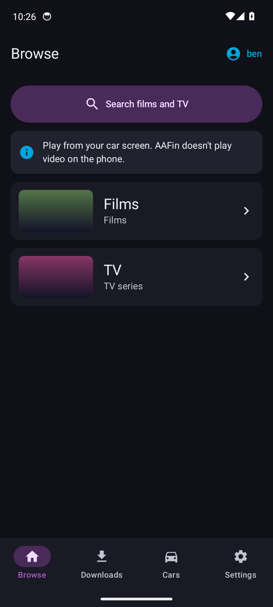
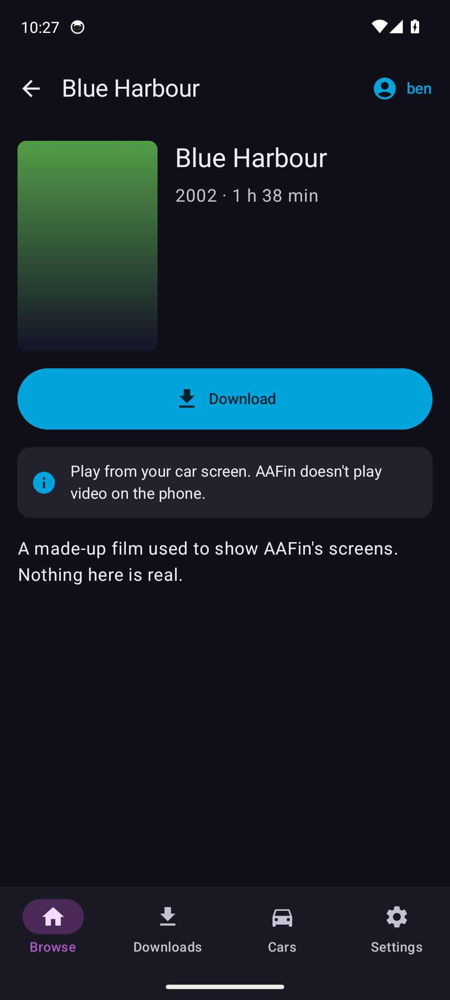
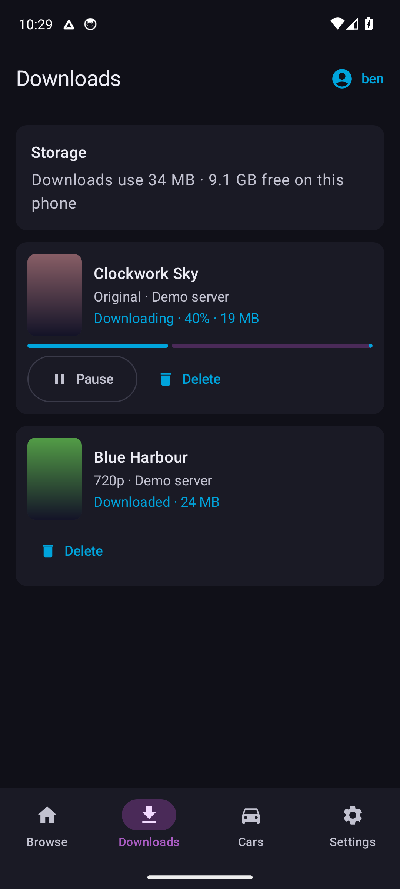
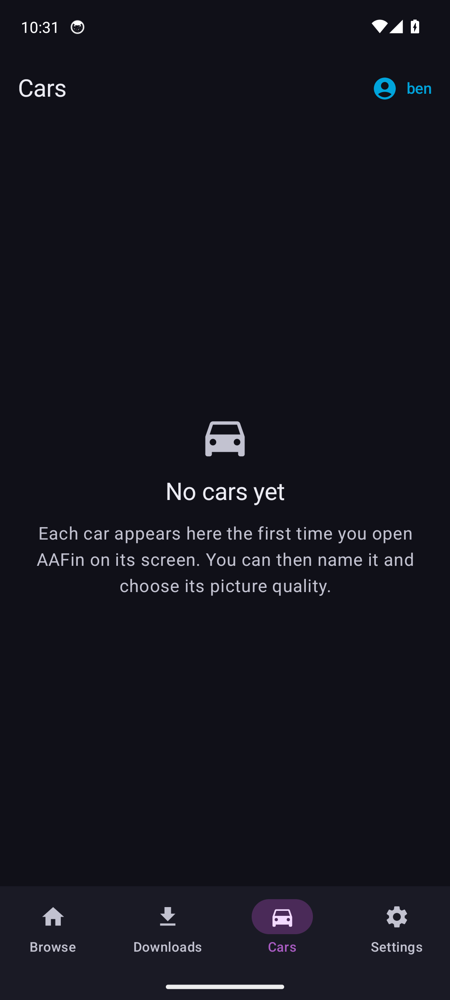

<p align="center">
  
</p>

<h1 align="center">AAFin</h1>

<p align="center"><strong>Watch your Jellyfin films and TV on an Android Auto car screen.</strong></p>

---

AAFin is a personal Android app. It's a native **Android Auto** app built with the Car App Library, so video plays on the car's own screen with **no screen mirroring**. The phone app handles sign-in, settings and downloads.

> **Not on the Play Store.** AAFin is sideloaded. Android Auto hides sideloaded apps until you allow them (see [Install](#install)).

## Features

| | |
|---|---|
| **Car screen playback** | Films and episodes play on the car display, with touch controls and steering-wheel buttons |
| **Jellyfin sign-in** | **Quick Connect** (six-digit code) or username and password |
| **Multiple accounts** | Several servers or users; switch on the phone or in the car |
| **Auto quality** | Sized to the car screen, matched to the connection, steps down if it stalls |
| **Per-car profiles** | Each car is detected automatically and keeps its own quality setting |
| **Offline downloads** | Download in **720p** or **Original** for journeys with no signal |
| **Watch progress sync** | Resume points go back to Jellyfin; offline progress is sent later |

**Films and TV only.** No music, no live TV and no playback on the phone itself.

## Screenshots

<p>
  
  
  
  
</p>

## Requirements

- **Android 10+** phone with Android Auto
- A **Jellyfin** server (**10.10 or newer**; HTTPS preferred)
- A car or head unit with **Android Auto** (wired or wireless)

## Install

**Download:** [latest release](https://github.com/BBBannon/AAFin/releases/latest) → `AAFin-vX.Y.apk`. Once installed, AAFin tells you when there's an update.

1. **Install the APK over USB, tagged as a Play Store install.** Android Auto is more likely to list the app this way.
   ```
   adb install -r -i com.android.vending AAFin.apk
   ```
2. **Allow unknown sources in Android Auto.**
   - Android Auto settings → tap **Version** ten times → **⋮ → Developer settings** → tick **Unknown sources**
3. **Check AAFin is ticked** in Android Auto → **Customise launcher**
4. **Open AAFin on the phone** and sign in to your server
5. **Connect to the car** and open AAFin from the car's app launcher

Full walkthrough: [`docs/PHONE-SETUP.md`](docs/PHONE-SETUP.md). The same checklist is in the app under **Settings → Open setup checklist**.

## Build from source

Needs **JDK 17** and the **Android SDK** (platform 35).

```
gradlew assembleDebug        # debug build
gradlew testDebugUnitTest    # unit tests
```

**Release builds** read signing details from a `keystore.properties` file in the project root. It's git-ignored, so you'll need your own:

```
storeFile=C:/path/to/your-release.jks
storePassword=...
keyAlias=...
keyPassword=...
```

**Publishing a release:** bump `versionCode`/`versionName`, add the ChangeLog line, commit, then run `pwsh -File release.ps1`. It tests, builds the signed APK on your PC, tags and uploads it to GitHub Releases. The signing key never leaves your machine.

**Testing without a car:** use Google's **Desktop Head Unit** (Android SDK → `extras;google;auto`, **v2.1 or newer**). See [`docs/DHU-TEST-PLAN.md`](docs/DHU-TEST-PLAN.md).

## How it works

- Android Auto only gives a drawing surface to **navigation** apps, so AAFin declares itself in the **NAVIGATION** category and draws video onto that surface with **Media3 ExoPlayer**
- **Jellyfin Kotlin SDK** for sign-in and browsing, **Jetpack Compose** for the phone app, **DataStore** and **WorkManager** for storage and background sync

Details: [`docs/ARCHITECTURE.md`](docs/ARCHITECTURE.md) · [`docs/SPEC.md`](docs/SPEC.md)

## Limitations

- **No Netflix, Prime or other DRM services.** Protected video can't be drawn on the car surface.
- **Not allowed on the Play Store.** Google doesn't permit video apps in the navigation category.

## Responsible use

AAFin doesn't block video while the car is moving. **Watching video while driving is dangerous and illegal in many countries.** Use it when parked, or for passengers only where the law allows. You use it at your own risk.

## Licence

**GPL-3.0** — see [`LICENSE`](LICENSE). Free to use, change and share, but any copy or modified version must also stay free and open source under the same licence.

## Disclaimer

AAFin is an independent project. It isn't affiliated with or endorsed by **Jellyfin** or **Google**. Android Auto is a trademark of Google LLC.
